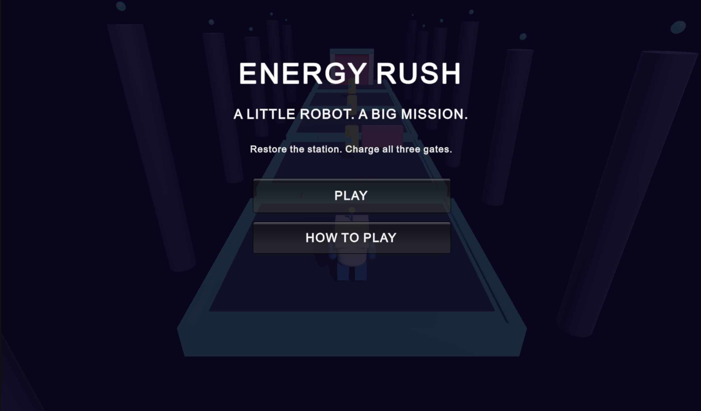
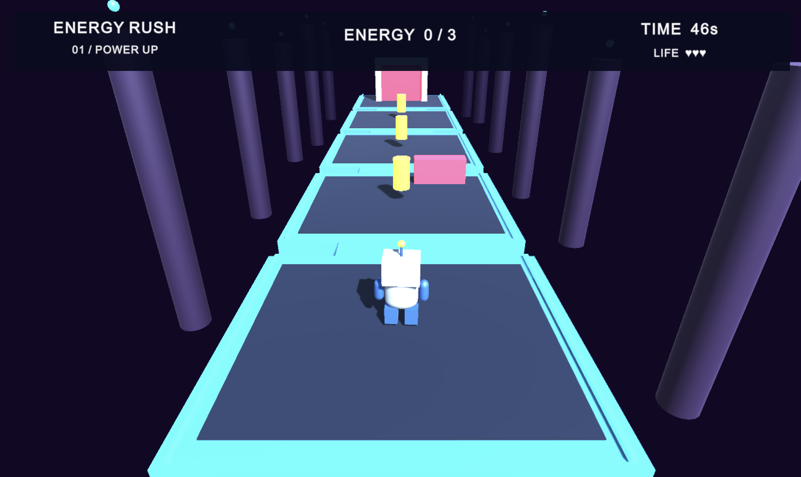
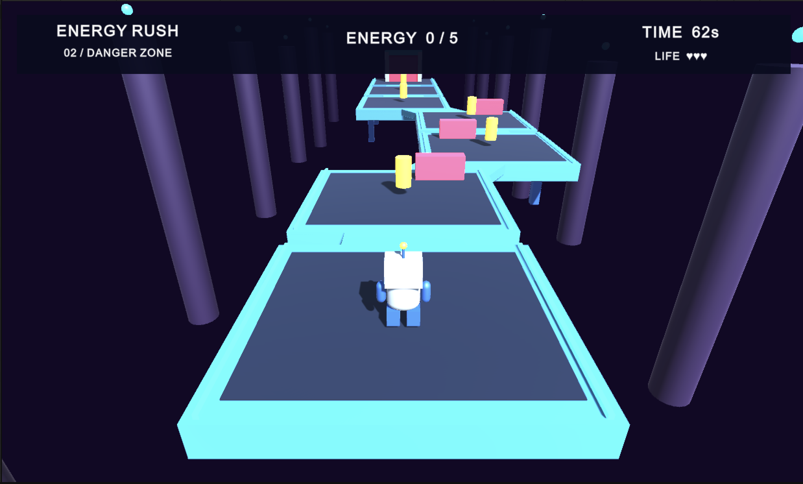
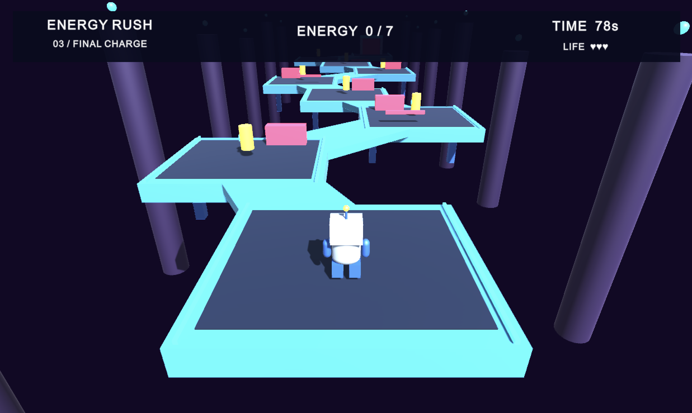
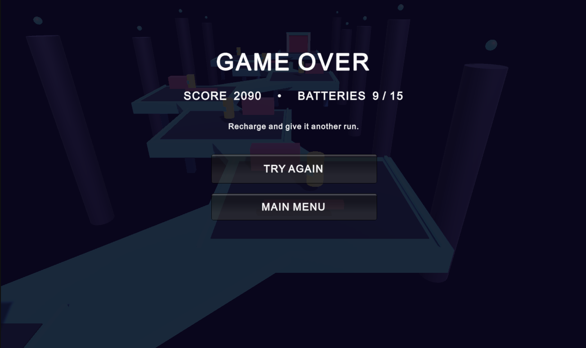

# ⚡ ENERGY RUSH

### A Little Robot. A Big Mission.

*A 3D Adventure Game Built with Unity & C#*

---

## 📖 About the Game

*Energy Rush* is a 3D adventure game developed using Unity and C#.

Players control a small robot on a mission to restore power to a futuristic energy station.

The robot must collect energy batteries, avoid obstacles, navigate challenging platforms, and reach the energy gates before time runs out.

The game features three unique levels with increasing difficulty, colorful low-poly environments, and interactive gameplay mechanics.

---

## ✨ Game Features

•⁠  ⁠🎮 *Three Unique Levels* — Increasing difficulty and challenges.
•⁠  ⁠🔋 *Energy Collection* — Collect batteries to unlock energy gates.
•⁠  ⁠🚧 *Obstacle Avoidance* — Dodge obstacles and navigate platforms.
•⁠  ⁠❤️ *Health System* — Three lives to survive each level.
•⁠  ⁠⏱️ *Countdown Timer* — Complete the mission before time runs out.
•⁠  ⁠🤖 *Robot Character* — Control a small robot in a futuristic environment.
•⁠  ⁠🏆 *Win & Game Over Screens* — Interactive game results and restart options.
•⁠  ⁠🌌 *3D Environment* — Colorful low-poly graphics and futuristic level design.

---

## 🕹️ Game Controls

| Key | Action |
|:---:|:---|
| ⁠ W ⁠ ⁠ A ⁠ ⁠ S ⁠ ⁠ D ⁠ | Move the robot |
| ⁠ Arrow Keys ⁠ | Move the robot |
| ⁠ Space ⁠ | Jump |
| ⁠ ESC ⁠ | Open the menu |

### 🎯 Objective

Collect all required energy batteries, avoid obstacles, and reach the energy gate to complete each level.

---

## 🏆 Game Levels

| Level | Name | Batteries | Time Limit |
|:---:|:---|:---:|:---:|
| 01 | Power Up | 3 | 60 seconds |
| 02 | Danger Zone | 5 | 75 seconds |
| 03 | Final Charge | 7 | 90 seconds |

Each level introduces new challenges, obstacles, and platform layouts.

---

## 📸 Game Screenshots

| Main Menu | Level 01 – Power Up |
|:---:|:---:|
|  |  |

| Level 02 – Danger Zone | Level 03 – Final Charge |
|:---:|:---:|
|  |  |

| Game Over |
|:---:|
|  |

---

## 🚀 Getting Started

### Requirements

•⁠  ⁠Unity Hub
•⁠  ⁠Unity 6.6 or a compatible version
•⁠  ⁠macOS or Windows
•⁠  ⁠Git (optional)

### ▶️ Run in Unity

1.⁠ ⁠Download or clone this repository.
2.⁠ ⁠Open *Unity Hub*.
3.⁠ ⁠Click *Add → Add project from disk*.
4.⁠ ⁠Select the downloaded ⁠ Energy-Rush ⁠ folder.
5.⁠ ⁠Open the project using a compatible Unity Editor.
6.⁠ ⁠Navigate to ⁠ Assets/Scenes/EnergyRush.unity ⁠.
7.⁠ ⁠Click the *Play* button to start the game.

### 🎮 Play the Game on macOS

If a packaged macOS build is available in Releases:

1.⁠ ⁠Download the latest macOS ZIP file.
2.⁠ ⁠Extract the downloaded archive.
3.⁠ ⁠Open ⁠ Energy Rush.app ⁠.
4.⁠ ⁠Start playing!

---

## 🛠️ Technologies Used

| Technology | Description |
|:---|:---|
| Unity | 3D Game Engine |
| C# | Gameplay Programming |
| Unity 3D | Level and Environment Design |
| Unity UI | Menus and Game Interface |
| macOS | Game Build Platform |

---

## 📂 Project Structure

⁠ text
Energy-Rush/
│
├── Assets/
│   ├── Editor/
│   ├── Materials/
│   ├── Resources/
│   ├── Scenes/
│   └── Scripts/
│
├── Packages/
├── ProjectSettings/
│
├── Screenshots/
│   ├── Main-Menu.png
│   ├── level-1.png
│   ├── level-2.png
│   ├── level-3.png
│   └── Game-Over.png
│
└── README.md
 ⁠

---

## 💡 What I Learned

This project provided practical experience in:

•⁠  ⁠Developing 3D games using Unity.
•⁠  ⁠Implementing gameplay mechanics with C#.
•⁠  ⁠Designing interactive game levels.
•⁠  ⁠Creating obstacle and collision systems.
•⁠  ⁠Managing player health and energy collection.
•⁠  ⁠Building interactive user interfaces.
•⁠  ⁠Testing and building a playable game.

---

## 👩‍💻 Developer

*Renad Alotaibi*

Information Technology Student

Imam Mohammad Ibn Saud Islamic University (IMSIU)

[GitHub Profile](https://github.com/renadalotaiibi0)

---

### ⚡ ENERGY RUSH

*Power Up. Keep Moving. Complete the Mission.*

Made with Unity & C#

